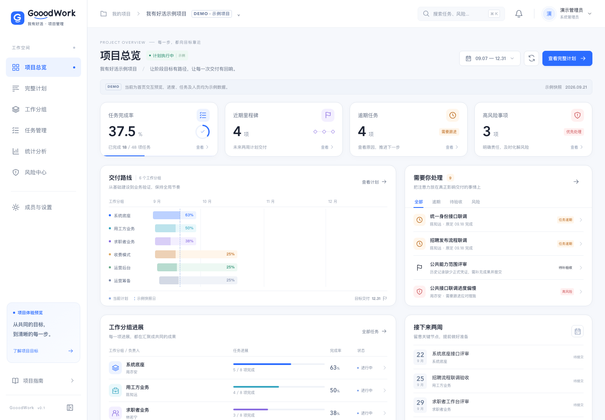
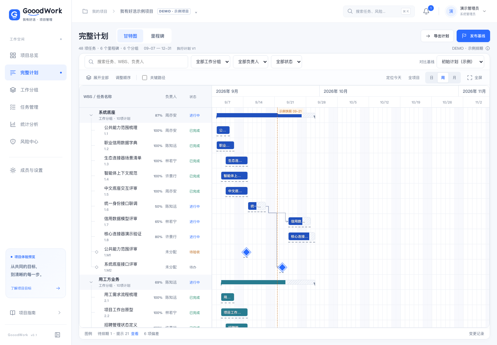
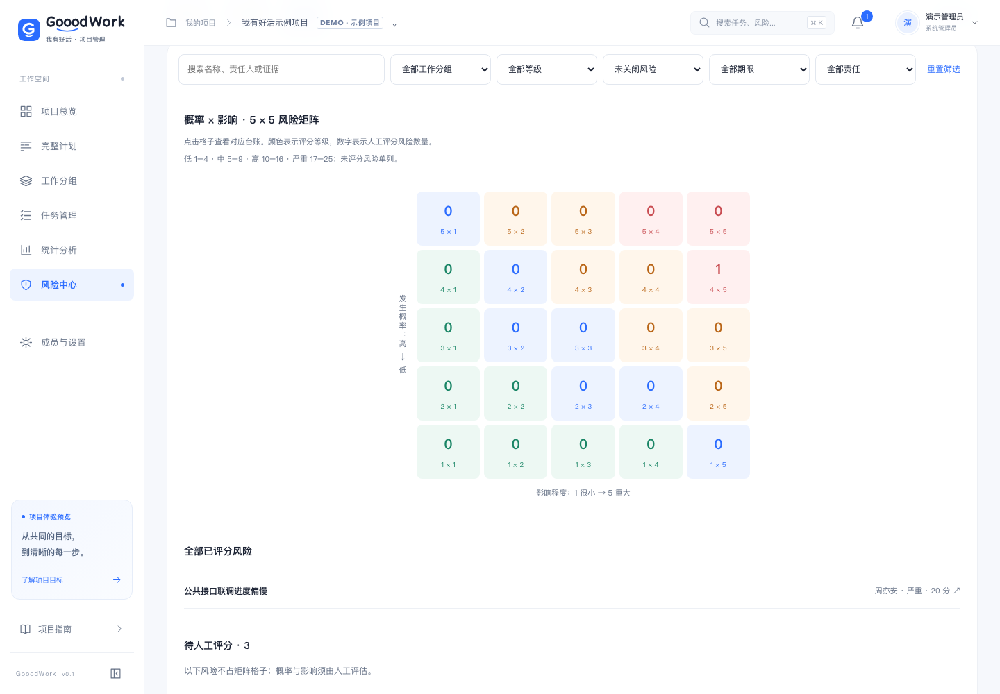

# Project MS · GooodWork 项目管理

面向小团队的自托管项目管理系统。用甘特图排期、用看板跟踪任务、用风险矩阵确定处理优先级。支持 Docker Compose 部署，数据保存在本地 SQLite。

Self-hosted project management with Gantt planning, task boards, and risk tracking. Contributions are welcome.

[快速开始](#快速开始) · [界面一览](#界面一览) · [技术文档](#技术文档) · [参与贡献](#参与贡献)



*项目总览 · 在一屏查看项目进展、待处理事项与近期计划。*

## 快速开始

```sh
git clone https://github.com/feiren24/project-ms.git
cd project-ms
```

### 用 Docker 启动

安装 Docker Engine 或 Docker Desktop，以及 Docker Compose v2。然后运行：

```sh
docker compose run --build --rm app npm run auth:bootstrap -- --self-hosted /app/data/homepage-demo.sqlite
docker compose up -d
docker compose ps
```

第一条命令会提示输入登录账号、姓名和密码。打开 [http://127.0.0.1:3100/login](http://127.0.0.1:3100/login)，用刚创建的管理员登录。SQLite、备份和系统生成的集成密钥保存在 Compose 数据卷中。以后启动直接执行 `docker compose up -d`。

### 用 Node 本地运行

安装 Node **24.13.1**（见 `.node-version`），在交互终端运行：

```sh
npm ci
npm run auth:bootstrap
npm run dev
```

打开 [http://127.0.0.1:5174/login](http://127.0.0.1:5174/login)。前端使用 5174 端口，API 使用 3100 端口。开发数据库位于 `data/homepage-demo.sqlite`。首次启动提供一个标注为 DEMO 的示例项目，也可以创建属于自己的空白项目。

## 界面一览

截图使用系统内置的 DEMO 数据，风险矩阵包含一项演示评分。

### 甘特计划



把排期、依赖关系和关键节点放在同一条时间轴上。

### 任务看板


按任务状态梳理工作，查看哪些事项正在推进、由谁负责。

### 风险矩阵



用影响程度和可能性划分风险，定位应优先处理的事项。

## 技术文档

- [系统架构](docs/architecture.md)解释 Vue、Fastify、SQLite 和后台作业如何协作。
- [开发指南](docs/development.md)包含本地开发、代码导航和测试命令。
- [核心 API](docs/api.md)提供登录、创建项目、读取任务和甘特计划的可执行示例。
- [使用指南](docs/user-guide.md)介绍创建项目、任务、计划和添加成员。
- [部署指南](docs/deployment.md)涵盖 HTTPS、已有库、备份和恢复。

## 参与贡献

从[贡献指南](CONTRIBUTING.md)搭建开发环境。遇到问题或有功能建议，可以在 [GitHub Issues](https://github.com/feiren24/project-ms/issues) 提交可复现的例子，也欢迎通过 Pull Request 改进代码和文档。漏洞请使用[私密报告](SECURITY.md)。

本仓库采用 [MIT 许可证](LICENSE)。
