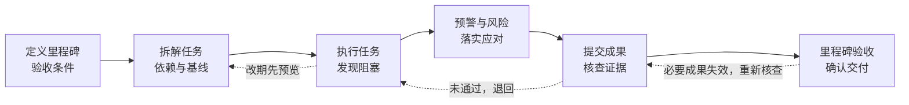
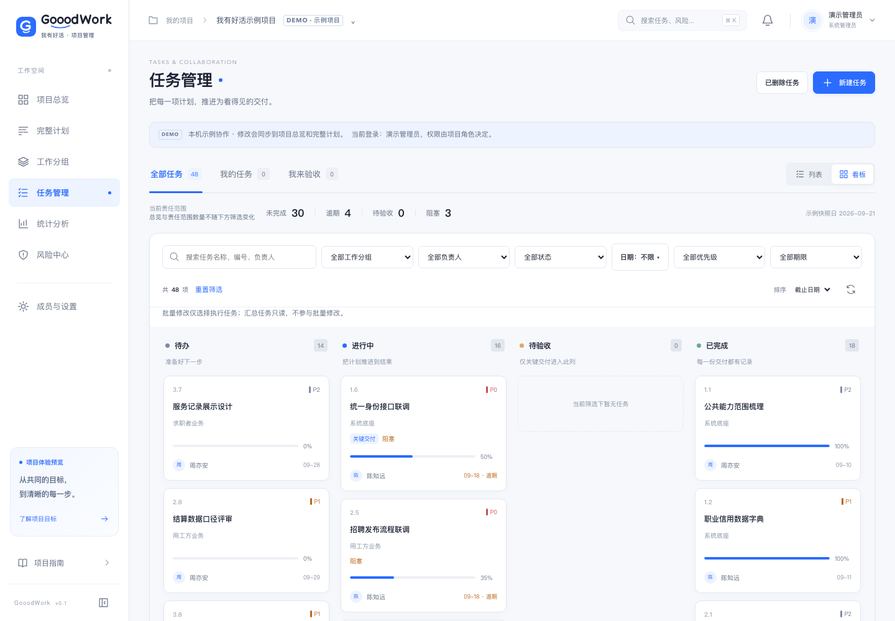

<div align="center">

# Project MS · GooodWork

### 不止管理任务，更要掌控交付。

**面向结果与交付的开源项目管理系统**

计划可推演 · 风险可管控 · 成果可验收 · 交付可追溯

*Delivery-first, self-hosted project management. Plan with confidence. Deliver with evidence.*

[](LICENSE) [](docs/deployment.md) [](docs/architecture.md)

[快速开始](#快速开始) · [为什么选择 Project MS](#为什么选择-project-ms) · [界面一览](#界面一览) · [技术架构](docs/architecture.md) · [参与贡献](#参与贡献)

</div>


## 项目最大的风险，不是任务没完成，而是交付失控。

当联调推迟三天，你能否在修改计划之前知道哪些任务与里程碑会受影响？

当任务都被标为完成，你能否确认关键成果已经通过验收？

当项目出现风险，你能否找到责任人、应对措施和关闭依据？

**Project MS 将这些问题变成日常工作的一部分。** 它以交付目标和里程碑为主线，把依赖排期、任务执行、风险应对、成果验收与计划偏差放进同一套管理闭环，而不是让项目经理在不同表格、看板和群消息之间拼凑答案。

## 为什么选择 Project MS

| 项目经理真正需要回答的问题 | Project MS 的原生管理能力 |
| --- | --- |
| **改动一项任务，会影响什么？** | 甘特图联动排期，先预览后提交，查看受影响任务与里程碑。 |
| **原来承诺的交付日期还能守住吗？** | 发布计划基线，对比当前计划与实际完成情况，追踪偏差；按剩余工期与依赖预测里程碑。 |
| **完成任务，是否真的交付了成果？** | 关键任务提交成果说明或链接，按验收标准通过或退回，保留提交和审核记录。 |
| **里程碑达到日期，就算达成了吗？** | 绑定必要任务与证据条件，满足提交条件后验收；必要成果或前置交付失效时触发复核。 |
| **哪些风险必须优先处理？** | 规则预警、概率 × 影响风险矩阵、风险责任人、应对任务及关闭复核。 |
| **项目数据由谁掌控？** | MIT 开源，支持 Docker Compose 自托管，SQLite 数据及备份由部署方管理。 |

### 与 Jira、飞书项目有什么不同？

Jira 擅长工作项追踪、敏捷研发与跨团队协作；飞书项目擅长可定制的流程协同与飞书生态融合。Project MS 选择更聚焦的产品方向：**给项目交付负责人一套开箱即用的交付治理工作空间。**

| 产品设计重心 | Jira | 飞书项目 | Project MS |
| --- | --- | --- | --- |
| 核心体验 | 工作项、迭代、看板与协作 | 工作项、流程配置与组织协同 | **里程碑、计划承诺与交付结果** |
| 计划管理重点 | 工作项排期、依赖与高级规划 | 多视图排期、流程与项目基线 | **改期影响预览 → 确认变更 → 基线偏差** |
| 交付管理重点 | 工作项状态与工作流，可按团队配置 | 流程节点、角色和交付物，可按场景配置 | **必要条件、成果证据、指定验收与失效复核** |
| 风险管理重点 | 依赖、阻塞与风险协作 | 风险跟踪、预警与流程协同 | **规则预警 → 风险评估 → 应对任务 → 关闭复核** |
| 生态与部署取向 | Atlassian 生态与丰富扩展 | 飞书生态与可配置平台 | **MIT 开源、自托管、可选飞书群通知** |

这不是功能有无或全部版本的对照表。Jira 和飞书项目也提供依赖、规划、风险或流程管理等能力；Project MS 的差异在于默认业务模型、聚焦交付的工作方式以及轻量自托管路径。参考 [Jira 官方功能](https://www.atlassian.com/software/jira/features)、[飞书项目官方产品介绍](https://project.feishu.cn/home/product)。

## 一个完整的交付闭环

以一次软件上线为例：



- **计划阶段：** 定义上线里程碑及必要交付条件，拆解工作分组和执行任务，设置依赖关系，发布计划基线。
- **执行阶段：** 跟进负责人、工期、进度与阻塞；调整排期前先查看受影响范围，确认后再应用。
- **风险阶段：** 识别逾期、依赖阻塞、里程碑预测延迟等预警；按需转为风险，创建或关联应对任务，提交关闭复核。
- **验收阶段：** 关键任务提交成果，里程碑逐项检查必要条件，保留通过、退回与复核记录。必要成果失效时，不能继续把旧验收当成有效交付。

## 界面一览

以下截图来自系统内置 DEMO 数据，风险矩阵包含一项演示评分。

### 01 · 计划推演：先看影响，再改计划


甘特图不仅用来展示时间。调整日期与依赖时，先检查后续任务及里程碑受到的影响，再确认保存。基线记录原有承诺，关键路径及预测帮助识别排期问题。

### 02 · 成果验收：完成不等于交付



普通任务可以直接完成；关键任务需提交成果并接受验收。里程碑还可以绑定必要任务和证据条件，记录验收结果，并在相关成果失效后进入复核。

### 03 · 风险治理：从预警到应对再到关闭


系统根据可用数据评估逾期、依赖阻塞、持续阻塞、里程碑预测延迟、容量超载、承诺不完整等预警。预警可转为风险，风险可关联或创建应对任务，并按风险状态跟进和复核关闭。

### 04 · 统计分析：不仅看完成率，更看交付质量

从基线偏差、里程碑达成、按时完成、工作分组、人员负荷等视角了解项目表现。指标保留数据覆盖情况；当日历、容量或排期依据不足时，不把未知结果伪装成确定结论。

## 适合哪些团队？

- 软件研发、产品上线与版本交付团队：需要将任务、前置依赖与上线验收关联起来。
- 客户实施、技术服务与交付团队：需要明确交付标准、责任人和验收记录。
- 中小企业项目负责人、PMO：需要关注排期偏差、风险应对和成果质量，而不是维护复杂的项目流程平台。
- 重视数据自主权的团队：希望在自己的服务器运行、备份和扩展项目管理系统。

Project MS 当前聚焦项目级交付治理。如果主要需求是大型组织的复杂流程定制、庞大的插件市场或跨企业协作生态，请结合实际场景评估 Jira、飞书项目及其他工具。

## 快速开始

```sh
git clone https://github.com/feiren24/project-ms.git
cd project-ms
```

### 用 Docker 启动

安装 Docker Engine 或 Docker Desktop，以及 Docker Compose v2。首次运行：

```sh
docker compose run --build --rm app npm run auth:bootstrap -- --self-hosted /app/data/homepage-demo.sqlite
docker compose up -d
docker compose ps
```

第一条命令会提示输入登录账号、姓名和密码。打开 [http://127.0.0.1:3100/login](http://127.0.0.1:3100/login)，用刚创建的管理员登录。SQLite、备份和系统生成的集成密钥保存在 Compose 数据卷中。以后启动直接执行 `docker compose up -d`。

### 用 Node 本地运行

安装 Node **24.13.1**（见 `.node-version`），在交互终端运行：

```sh
npm ci
npm run auth:bootstrap
npm run dev
```

打开 [http://127.0.0.1:5174/login](http://127.0.0.1:5174/login)。前端使用 5174 端口，API 使用 3100 端口。开发数据库位于 `data/homepage-demo.sqlite`。首次启动提供一个标注为 DEMO 的示例项目，也可以创建自己的空白项目。

## 技术架构与文档

Project MS 使用 TypeScript、Vue 3、Fastify、SQLite 与 ECharts。自托管实例由一个 Node.js 进程提供前端和 API，后台作业支持通知、统计和备份；飞书群通知可按项目配置。业务写入采用权限校验、版本检查和幂等控制等机制。

| 文档 | 内容 |
| --- | --- |
| [系统架构](docs/architecture.md) | 模块边界、数据与后台作业、系统架构图 |
| [开发指南](docs/development.md) | 本地开发、代码导航与测试命令 |
| [核心 API](docs/api.md) | 会话认证、项目、任务和计划接口 |
| [使用指南](docs/user-guide.md) | 创建项目、任务、计划、成员与通知 |
| [部署指南](docs/deployment.md) | HTTPS、已有库、备份和恢复 |

核心机制源码：[计划预览与基线](server/src/modules/planning/repository.ts) · [任务验收](server/src/modules/tasks/repository.ts) · [里程碑验收](server/src/modules/milestones/repository.ts) · [交付失效复核](server/src/modules/milestones/store.ts) · [风险治理](server/src/modules/risks/service.ts)。

**能力边界：** 当前排期依赖以 FS（完成-开始）为主；里程碑预测基于可用工期、进度和依赖数据，不做资源平衡，也不是交付日期保证。请按实际团队规模与安全要求评估部署。

## 参与贡献

如果你认同「不止管理任务，更要掌控交付」的理念，欢迎为项目点亮 Star，或者一起完善开源交付管理工具。

从[贡献指南](CONTRIBUTING.md)搭建开发环境。在 [GitHub Issues](https://github.com/feiren24/project-ms/issues) 提交可复现的问题或功能建议，也欢迎通过 Pull Request 改进代码和文档。安全漏洞请使用[私密报告](SECURITY.md)。

本仓库采用 [MIT 许可证](LICENSE)。
