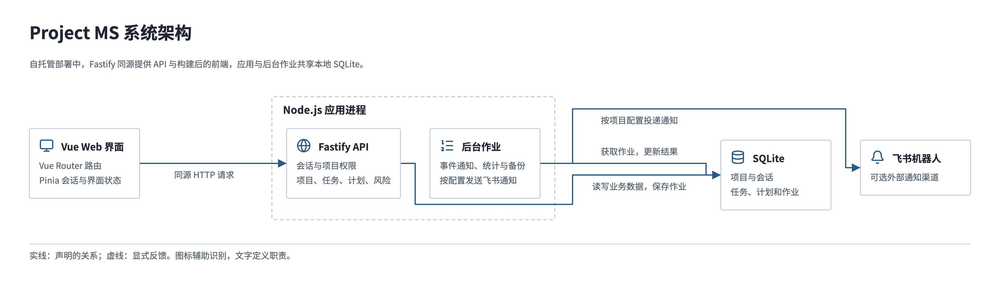

# 系统架构

Project MS 的自托管实例由一个 Node.js 进程提供页面和 API。浏览器运行 Vue，Fastify 在同一源下提供构建后的前端和业务路由。业务数据、用户会话、后台作业都保存在本地 SQLite 中。

[可编辑源文件](architecture/diagram.json) · [SVG](architecture/diagram.svg) · [独立 HTML](architecture/diagram.html)

## 模块与职责

| 位置 | 职责 |
| --- | --- |
| [client/src](../client/src) | Vue 页面、路由、Pinia 存储和 API 调用。工作空间按项目切换总览、完整计划、任务、风险、统计和设置。 |
| [shared/src](../shared/src) | 前后端共用的请求与响应类型、任务状态、权限、计划和排序规则。 |
| [server/src/app.ts](../server/src/app.ts) | 组装 Fastify、注册业务模块和作业，按部署配置托管客户端。 |
| [server/src/modules](../server/src/modules) | 按项目、任务、计划、风险、通知等组织接口和业务规则。路由负责 HTTP 层，服务和存储代码负责校验与持久化。 |
| [server/src/db](../server/src/db) 与 [server/src/jobs](../server/src/jobs) | SQLite 初始化、结构校验和后台作业执行。飞书集成由对应项目配置启用。 |

## 一次任务写入如何完成

1. [任务 API 客户端](../client/src/api/tasks.ts) 从当前项目发起请求。会话由 Cookie 识别，写入请求附带 CSRF 令牌和幂等键。
2. [认证与授权层](../server/src/modules/auth/index.ts) 检查登录状态、项目范围和角色。任务路由把请求交给 [任务存储模块](../server/src/modules/tasks/repository.ts)，由它校验允许的状态变化和需要核对的数据版本。
3. 成功写入时，SQLite 在同一事务中保存任务与关联计划数据，并写入相关项目事件、作业及幂等回执。同一个幂等键用于重试同一操作。
4. [后台作业](../server/src/jobs/runner.ts) 从数据库领取符合执行条件的作业，处理站内通知、统计与备份。启用飞书通知时，[飞书模块](../server/src/modules/feishu) 管理其投递和结果。

## 部署与数据

开发环境由 Vite 提供热更新并将 API 请求代理给 Fastify。自托管时先初始化完整数据库，再用 `existing-only` 模式启动。部署后的数据库结构会在启动时核对。容器部署通过持久数据卷保存数据库、备份和系统生成的集成密钥。恢复已有实例时请同时核对数据和密钥，详见[部署指南](deployment.md)。

接下来可用[开发指南](development.md)定位改动与测试，或者沿[核心 API 示例](api.md)查看请求与响应。
